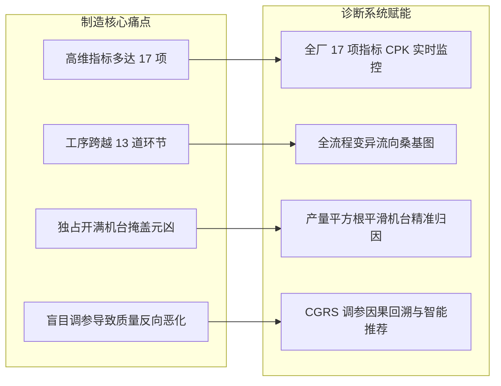
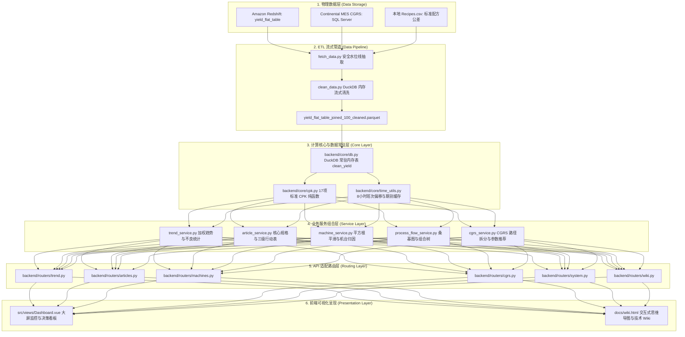

# 01. 系统全景架构与工程规范

---

## 1. 系统定位与核心业务目标

本项目为**轮胎生产质量数据分析与可视化诊断系统 (Tire Weight & Uniformity Analysis & Cpk Diagnostics System)**。
在轮胎高端制造中，轮胎的**重量 (Weight)**、**均匀性 (Uniformity，如 RFPP/LFPP/CONY 等力学波动)**、**动平衡 (Dynamic Balance)** 及**几何跳动 (Geometry)** 是决定整车高速行驶安全性、颠簸感与静音性的绝对核心指标。



系统核心解决四大业务痛点：
1. **指标统一监控**：统一全厂 17 项检测指标的配方公差、标称量纲，实时呈现全厂/规格加权 CPK 与 SPC 控制限；
2. **全流程穿透溯源**：打通从原材料、半部件批次 (Lot)、成型 (GT)、硫化 (CT) 到终检 (TU) 的完整时序血缘；
3. **精准瓶颈定位**：利用**产量平方根平滑算法**消除超大产量机台的“替人背黑锅”效应，揪出真实劣化设备；
4. **闭环工艺干预**：结合 Continental MES CGRS 调参变动日志，回溯工艺修改效果，为车间工程师提供高置信度的参数优化建议。

---

## 2. 全栈技术选型与运行环境

| 分层 | 技术选型 | 版本/组件要求 | 核心职能 |
| :--- | :--- | :--- | :--- |
| **前端应用** | Vue 3 + Vite | Vue 3.4+ (Composition API / Setup) | 现代化响应式组件化架构 |
| **UI 视图库** | Element Plus | 2.6+ (暗黑/微立体质感定制) | 统一规范的对话框、表格、徽章、工具栏 |
| **可视化图表**| ECharts 5 | 5.5+ (vue-echarts 封装) | 桑基图 (Sankey)、双轴趋势图、树图 (Tree) |
| **状态流转** | Pinia | 2.1+ | 全局响应式状态机 (`filterStore`) |
| **后端服务** | Python FastAPI | FastAPI 0.100+, Uvicorn 0.22+ | 高性能异步 ASGI 接口服务与路由装配 |
| **分析计算引擎**| DuckDB | DuckDB 0.9.2+ (常驻内存 + 临时盘) | 亿级列存 Parquet 极速流式聚合与 Out-of-Core 计算 |
| **数据科学工具**| Pandas, NumPy | Pandas 2.0+, NumPy 1.24+ | 时序补齐、统计学方差/分位数/矩阵运算 |
| **上游连接** | psycopg2 / pyodbc | Redshift PostgreSQL 驱动, ODBC SQL Server | 跨库自动化 ETL 增量拉取 |

---

## 3. 六层架构拓扑与数据流向

整个工程代码严格遵循六层高内聚分层设计：



---

## 4. 依赖隔离铁律与服务解耦注入机制

为彻底杜绝 Python 大项目中常见的“循环导入 (Circular Import)”与“偶合灾难”，工程制定了三项刚性架构原则：

### 4.1 核心层单向依赖原则 (Strict Downward Imports)
* `backend/core/` 目录下的纯函数工具（`cpk.py`, `indicators.py`, `db.py`, `time_utils.py`）**绝对严禁反向 import `backend/services/`**。
* 核心层函数必须保持为**确定性纯函数 (Pure Functions)**，仅接收入参并返回计算结果。

### 4.2 跨服务运行时动态依赖注入 (Runtime Helper Injection)
* 当 `article_service.py` 需要调用 `machine_service.py` 的机台预警算法，或 `process_flow_service.py` 需要调用 `cgrs_service.py` 的调参对比时，**禁止在文件顶部互相静态 import**。
* 统一采用**延迟解析钩子或动态注入**模式：

```python
# 代码位置：backend/services/article_service.py:L24-67
_top_warning_provider = None
_best_tu_provider = None
_cgrs_cpk_comparator = None

def _get_top_warning_provider():
    global _top_warning_provider
    if _top_warning_provider is None:
        try:
            from backend.services.machine_service import get_top_warning_machines
            _top_warning_provider = get_top_warning_machines
        except Exception:
            pass
    return _top_warning_provider
```

### 4.3 路由控制层精简化 (< 80 行装配)
* `backend/main.py` 严格保持为精简装配器，仅负责中间件挂载、全局常驻连接初始化与子路由聚合，禁止编写具体业务 SQL 或复杂清洗逻辑。

---

> [!TIP]
> **下一章导航**：
> 了解了整体架构后，请阅读 [02. 全流程数据源与实体关系拓扑](02_data_sources_and_er.md)，深入掌握三大物理数据源结构与 13 道工序数据字典。
