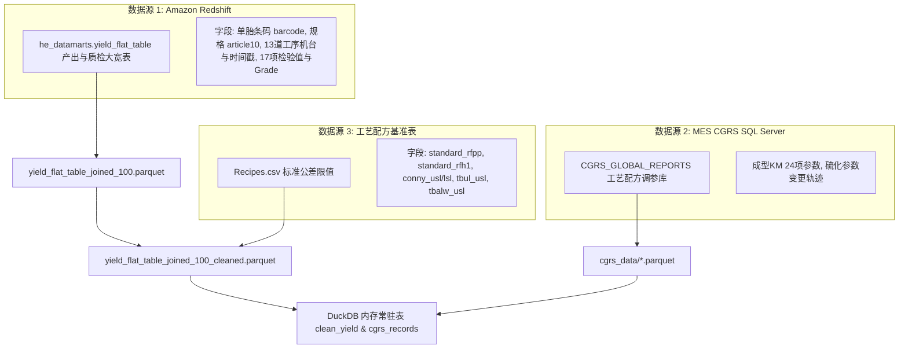
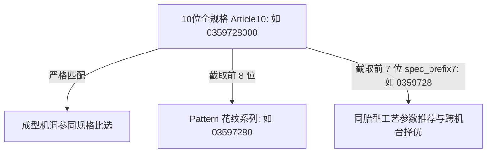

# 02. 全流程数据源与实体关系拓扑 (Data Sources & ER Flow)

---

## 1. 三大物理数据源与抽取边界

系统的分析中枢由三大物理数据源共同供数，各数据源职能与技术参数如下：



### 1.1 数据源 1：Amazon Redshift 产出与质检大宽表
* **连接配置**：
  * 主机：配置于 `backend/config/db_config.json`（经 XOR 密钥加密）
  * 端口：`5439`，数据库：`mustangmaster`，模式/表：`he_datamarts.yield_flat_table`
* **抽取口径**：
  * 全量回溯时间窗：默认抽取过去 31 天数据：`tu_first_shift_date >= CURRENT_DATE - INTERVAL '31 day'`；
  * 增量抽取基准：依据本地已有数据的最大终检时间戳安全回退 1 天 (`safe_watermark`)。
* **业务含义**：以**单胎条码 (`barcode`)** 为主键，记录该轮胎在工厂内从成型到终检流转的完整生命周期指标。

### 1.2 数据源 2：Continental MES CGRS 工艺调参数据库
* **连接配置**：
  * 服务器：`OTTM09RMSMS02.tiremes.contiwan.com\OTT_I1`
  * 数据库：`CGRS_GLOBAL_REPORTS`（基于 Windows 认证 / ODBC 连接）
* **核心抽取对象**：
  * **成型 KM 工序 (ProcessTypeID: 119)**：涵盖“IL 安装摩擦”、“安装高度_IL”、“左/右卷边罩位置”、“胶囊高压时间”等 24 项关键工艺参数；
  * **变动日志流**：每日增量导出为 `recipe_offset_changes_YYYYMMDD.parquet` 与配方基准 `recipe_offsets_YYYYMMDD.parquet`。

### 1.3 数据源 3：配方标准上限与公差基准表 (`Recipes.csv`)
* **文件位置**：`backend/data/Recipes.csv`
* **关联键**：`LPAD(TRIM(CAST(ART10 AS VARCHAR)), 10, '0')`（10位补零规格码）
* **业务含义**：提供轮胎行业最权威的质检放行标准上限（USL）与下限（LSL）。

---

## 2. 13 道工序流转与单胎生命周期

在 `backend/services/process_flow_service.py` 中，定义了全厂 13 道核心物理工段拓扑字典：

```python
# 代码位置：backend/services/process_flow_service.py:L21-35
WORKCENTER_STAGES = [
    {"key": "tread",       "col": "tread_workcenter",           "name": "胎面"},
    {"key": "bead",        "col": "bead_workcenter",            "name": "胎圈"},
    {"key": "inner_liner", "col": "inner_liner_workcenter",     "name": "内衬"},
    {"key": "sidewall",    "col": "sidewall_workcenter",        "name": "胎侧"},
    {"key": "breaker1",    "col": "first_breaker_workcenter",   "name": "带束层1"},
    {"key": "breaker2",    "col": "second_breaker_workcenter",  "name": "带束层2"},
    {"key": "ply1",        "col": "first_ply_workcenter",       "name": "帘布层1"},
    {"key": "cap1",        "col": "wound_cap_ply1_workcenter",  "name": "冠带层1"},
    {"key": "cap2",        "col": "wound_cap_ply2_workcenter",  "name": "冠带层2"},
    {"key": "gt",          "col": "gt_workcenter",              "name": "成型"},
    {"key": "ct",          "col": "ct_workcenter",              "name": "硫化"},
    {"key": "tu",          "col": "tu_first_workcenter",        "name": "终检"},
    {"key": "tb",          "col": "tb_first_workcenter",        "name": "动平衡"},
]
```

### 关键控制工步三元组 (GT ➔ CT ➔ TU)
在质量分析中，重点收敛于**“成型 (GT) ➔ 硫化 (CT) ➔ 终检 (TU)”**这三道物理变异影响最大的决定性工序：
* **成型 (GT, 如 TB254, GT02)**：帘布组装、胎圈贴合与生胎成型；
* **硫化 (CT, 如 CU621, CU704)**：高温高压胶囊硫化，机械应力定型；
* **终检 (TU, 如 TU05, TU19)**：均匀性试验机对轮胎径向力、侧向力与锥度进行高精度负荷传感器采样。

---

## 3. 规格层级关系与模糊匹配规范

为兼顾同胎型工艺相似性与严格控制要求，系统建立了三级规格解析体系：



1. **10 位全规格 (`article10`)**：
   - 包含花纹、尺寸、结构、负荷指数与速度级别的完整生产代码。
   - 在计算单规格加权 CPK、批次 Lot 追溯时，**100% 严格按 10 位匹配**。
2. **前 7 位系列 (`spec_prefix7`)**：
   - 工艺实践准则：前 7 位相同的规格拥有完全相同的胎胚结构几何尺寸和模具型腔。
   - **在 CGRS 参数推荐时，成型机与硫化机统一以 `spec_prefix7` 作为比选边界**，兼顾工艺同胎型的一致性与高匹配度。
   - **红线**：彻底删除了早期不合理的前 5 位模糊匹配，严禁越界推荐。

---

## 4. 核心数据表字段字典与外键映射

### 4.1 宽表核心字段清单 (`clean_yield`)
| 字段名 | 业务含义 | 数据类型 | 典型示例 | 关联/处理说明 |
| :--- | :--- | :--- | :--- | :--- |
| `barcode` | 单胎条码 | VARCHAR (主键) | `035972800012345` | 全流程唯一标识 |
| `article10` | 10位规格代号 | VARCHAR | `0359728000` | 关联配方表与指标上限 |
| `tu_first_loc_timestamp` | 终检出产时间戳 | TIMESTAMP | `2026-09-15 14:20:00` | 核心时间轴 |
| `tu_first_shift_date` | 生产排产班次日 | VARCHAR | `2026-09-15` | `timestamp - 8小时` 派生 |
| `gt_workcenter` | 成型机台编码 | VARCHAR | `TB254`, `GT02` | 对应三期/四期成型设备 |
| `ct_workcenter` | 硫化机台编码 | VARCHAR | `CU621`, `CUL02` | 对应三期/四期硫化机 |
| `tu_first_workcenter` | 终检机台编码 | VARCHAR | `TU05`, `TU19` | 对应均匀性检测机 |
| `ct_shop` | 厂区车间期别 | VARCHAR | `P3`, `P4` | 判定三期/四期归属 |
| `rfppwc_first` | 径向力峰峰值原始测量值 | DOUBLE | `102.5` | 计算时需 $\times 10$ 换算为牛 (N) |
| `cony_first` | 锥度效应力原始测量值 | DOUBLE | `45.2` | 单位为牛 (N)，双侧公差 |
| `tbul_first` | 上胎侧凸起测量值 | DOUBLE | `0.45` | ETL 清洗后已转为毫米 (mm) |
| `standard_rfpp` | RFPP 配方标准上限 | DOUBLE | `105.0` | 来自 `Recipes.csv` |
| `conny_usl / lsl` | CONY 配方上下限 | DOUBLE | `80.0 / -80.0` | 来自 `Recipes.csv` |

---

> [!TIP]
> **下一章导航**：
> 掌握了数据源与字典后，请阅读 [03. ETL 流式清洗管线与 DuckDB 内存引擎](03_etl_pipeline_and_engine.md)，了解如何将原始数据高效流式清洗至内存引擎中。
