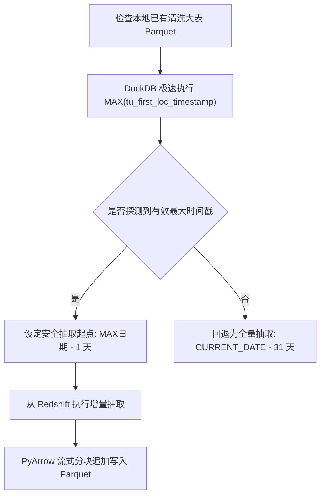

# 03. ETL 流式清洗管线与 DuckDB 内存引擎 (ETL Pipeline & Storage)

---

## 1. 增量拉取与安全水位线机制

数据抽取脚本位于 `backend/etl/fetch_data.py`。为兼顾效率与数据准确性，系统设计了**基于 Parquet 元数据的极速安全水位线 (Safe Watermark) 增量拉取机制**。



### 1.1 安全回退 1 天的设计动因
轮胎生产存在如下实际业务特征：
* **跨班次下线延迟**：早中晚三班交接或夜班（23:00~次日07:00）产出的轮胎，其终检检测时间可能在次日中午甚至隔天集中上传；
* **返工复检与重测**：部分异常轮胎在经打磨或返修后重新上机复检，产生修正后的测量记录。
* **对策**：如果直接以 `MAX(timestamp)` 增量，会遗漏由于回溯更新的旧胎记录。系统自动将水位线安全回退 1 天（`safe_watermark = max_dt - 1 day`），既保证了每天仅拉取 1~2 天的数据（耗时由 15 分钟降至 30 秒），又确保了数据的完整性和不漏单。

---

## 2. DuckDB 内存保护与溢出盘管理

在 `backend/etl/clean_data.py` 中，使用 DuckDB 原生 SQL 引擎对数百万行产出宽表进行原子清洗。为防止工业级服务器发生内存溢出 (OOM) 崩溃，配置了严格的**Out-of-Core 磁盘溢出保护**：

```python
# 代码位置：backend/etl/clean_data.py:L40-47
temp_dir = os.path.join(data_dir, "duckdb_tmp")
os.makedirs(temp_dir, exist_ok=True)
temp_dir_sql = temp_dir.replace("\\", "/")

# 启用磁盘溢出缓冲与内存保护，杜绝 Out of Memory Allocation failure
con.execute(f"PRAGMA temp_directory='{temp_dir_sql}'")
con.execute("PRAGMA max_memory='4GB'")
con.execute("PRAGMA threads=4")
```

* **`PRAGMA max_memory='4GB'`**：强制锁定 DuckDB 运行工作集上限为 4GB，剩余物理内存预留给操作系统的页面缓存与并发 Web 查询；
* **`PRAGMA temp_directory`**：当聚合或多表哈希连接超出 4GB 时，DuckDB 自动将中间临时块溢出落盘到 `duckdb_tmp` 目录，计算完成后自动回收，确保零内存泄漏。

---

## 3. 流式原子清洗与核心数据转换规则

清洗管线通过一条流式 SQL 完成四大业务清洗任务：

### 3.1 规则 1：TG 几何尺寸量纲统一 ($\times 1000$ 换算为 mm)
Redshift 原始库中，TG 几何尺寸字段（凸起、凹陷、跳动）以**米 (m)** 为单位存储（如 `0.00045`），而车间质检公差（`Recipes.csv`）以**毫米 (mm)** 为基准（如 `0.45mm`）。
在清洗步骤中，统一通过显式表达式乘以 1000：
```sql
-- 代码位置：backend/etl/clean_data.py:L251-258
ROUND(TRY_CAST(t.tbul_first AS DOUBLE) * 1000.0, 4) AS tbul_first,
ROUND(TRY_CAST(t.bbul_first AS DOUBLE) * 1000.0, 4) AS bbul_first,
ROUND(TRY_CAST(t.tdep_first AS DOUBLE) * 1000.0, 4) AS tdep_first,
ROUND(TRY_CAST(t.bdep_first AS DOUBLE) * 1000.0, 4) AS bdep_first,
ROUND(TRY_CAST(t.tlro_first AS DOUBLE) * 1000.0, 4) AS tlro_first,
ROUND(TRY_CAST(t.blro_first AS DOUBLE) * 1000.0, 4) AS blro_first,
ROUND(TRY_CAST(t.crro_first AS DOUBLE) * 1000.0, 4) AS crro_first
```

### 3.2 规则 2：17 项原生 Grade 字段规范化与全工序异常判定
* 原始 Grade 字段可能混杂 `'a'`, `'A '`, `''`, `NULL` 等非标字符；
* 清洗时统一执行 `NULLIF(UPPER(TRIM(CAST(t.grade_xx AS VARCHAR))), '')`；
* 异常判定准则：**任何一项指标的 Grade 非 `'A'` 且非空，即判定该工段异常**：
  * `is_anomaly_tu = 1`：RFPP, RFH1, RFH2, LFPP, LFH1, CONY, PLYS 中存在非 A 项；
  * `is_anomaly_tg = 1`：TBUL, BBUL, TDEP, BDEP, TLRO, BLRO, CRRO 中存在非 A 项；
  * `is_anomaly_tb = 1`：TBALW, BBALW, SBALW 中存在非 A 项；
  * 自动派生异常来源标签 `anomaly_sources`（如 `'TU+TG'`, `'TU+TB'`, `'NORMAL'`）。

### 3.3 规则 3：配方标准上限动态左连接 (`LEFT JOIN recipes_limits`)
* 将 `Recipes.csv` 中的公差预先过滤剔除无效占位编码（如 960, 990, 996 等工厂停用标记）；
* 通过 `LPAD(TRIM(CAST(ART10 AS VARCHAR)), 10, '0')` 关联，将最新的配方标准限无缝挂载到单胎大宽表中。

### 3.4 规则 4：原子文件替换 (Atomic File Swap)
* 清洗生成的文件首先写入临时文件 `yield_flat_table_joined_100_cleaned.parquet.cleaning.tmp`；
* 校验输出行数与校验码正确后，通过操作系统的原子重命名操作直接覆盖目标文件，确保正在读取旧文件的 Web 线程绝不报错中断。

---

## 4. 数据库配置加密与常驻连接热自愈

### 4.1 XOR 对称密钥加密 (`secret.key`)
为防止数据库密码明文泄露，`backend/etl/fetch_data.py` 实现了无三方依赖的 XOR 混淆加密：
* 生成 32 位随机安全密钥保存至 `backend/config/secret.key`；
* 数据库用户密码加密后存入 `backend/config/db_config.json`；
* 运行抽取脚本时内存解密，严禁向控制台或日志输出明文凭据。

### 4.2 DuckDB 内存常驻连接与自愈重载 (`backend/core/db.py`)
为实现毫秒级的看板查询响应，后端维护了一个全局的 DuckDB 内存连接：
* 系统启动时调用 `reload_duckdb_data()`，执行：
  ```sql
  CREATE OR REPLACE TABLE clean_yield AS 
  SELECT * FROM read_parquet('.../yield_flat_table_joined_100_cleaned.parquet')
  ```
* **自愈捕获机制**：在 `qry(sql, params)` 执行中，若由于 Parquet 正在被增量更新而触发 `duckdb.CatalogException`，连接层会自动捕获并静默触发一次 `reload_duckdb_data()` 并重试查询，实现零停机热自愈。

---

> [!TIP]
> **下一章导航**：
> 数据已清洗并就绪，请阅读 [04. 17项质检指标统一定义与标准 CPK 引擎](04_metrics_and_standard_cpk.md)，深入了解各项物理指标的计算公式与公差规则。
