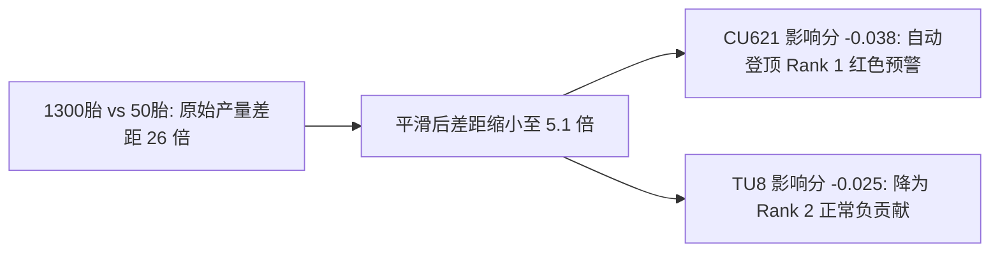
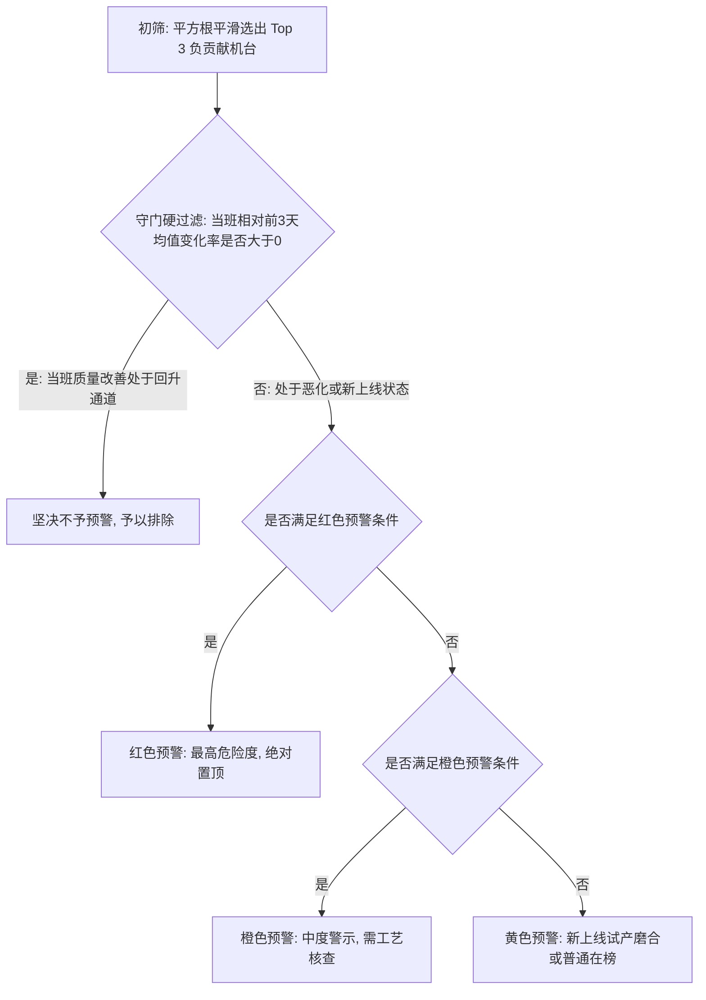
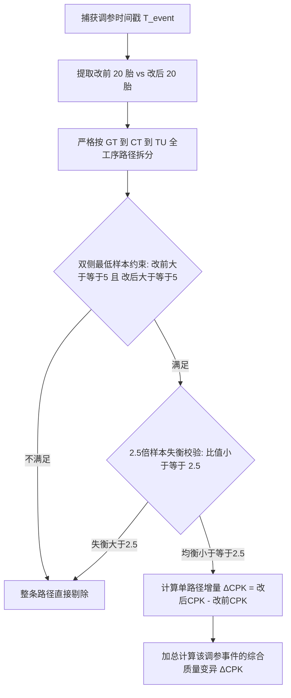

# 05. 核心归因算法与 CGRS 控制变量模型 (Core Algorithms & CGRS Engine)

---

## 1. 核心规格拉低贡献度评分 (Stable Score)

在全厂数百种在产规格中，系统需要精准识别出**谁是拉低全厂综合质量的最主要罪魁祸首**。
在 `backend/services/article_service.py:L804` 中，定义了规格负向贡献得分公式：

$$StableScore = (CPK_{\text{全厂加权综合}} - CPK_{\text{单规格}}) \times N_{\text{规格}}$$

### 核心物理内涵：
* $CPK_{\text{全厂加权综合}} - CPK_{\text{单规格}}$：度量了该规格偏离全厂平均水准的**质量恶化深度**；
* 乘以 $N_{\text{规格}}$（单日排产条数）：度量了该规格对大盘影响的**产量波及广度**；
* **结论**：单规格 CPK 越低、排产量越大，其负向拉低得分绝对值越大，在核心规格行动表中排序越靠前。

---

## 2. 产量平方根平滑机台贡献度算法 (Square-Root Volume Smoothing)

这是系统在 2026 年质量工程上的一项重大里程碑升级，彻底解决了工业归因中的**“大机台背锅悖论”**。

### 2.1 工业背景与旧算法痛点
* **旧算法逻辑**：采用线性产量占比 $\text{Volume} = \frac{N_{mach}}{N_{\text{total}}}$：
  $$\text{Impact Score}_{\text{old}} = Contrib \times \frac{N_{mach}}{N_{\text{total}}}$$
* **引发的严重误判**：
  * **满载机台替人背锅**：某终检机（如 `TU8`）全厂独占满负荷运行，承载 1300 胎（占 98% 产量），局部 CPK 虽有微小波动（如 1.25，略低于均值 1.28），由于乘以 0.98，其得分被无限放大，**长期被误判为全厂 Rank 1 第一大元凶**；
  * **真凶被彻底掩盖**：某硫化机（如 `CU621`）当班发生机械故障，CPK 直接暴跌至 **0.31**（濒临大面积废品），但因其仅生产 50 胎（仅占 9.6% 产量），被乘以 0.096 后，得分被线性压缩至 `-0.011`，**惨遭系统掩盖无视**！

### 2.2 数学公式重构
将线性产量权重升级为**产量平方根占比**：

$$ImpactScore = Contrib \times \frac{\sqrt{N_{mach}}}{\sum_{i} \sqrt{N_i}}$$

其中：
* $Contrib = CPK_{mach} - CPK_{\text{受控对齐基准}}$
* $\sqrt{N_{mach}}$：对极值产量进行亚线性平滑压缩。



### 2.3 代码实现
```python
# 代码位置：backend/services/machine_service.py:L825-851
volume = mach_tires / total_tires
sqrt_tires = math.sqrt(mach_tires)

total_sqrt_tires = sum(m["sqrt_tires"] for m in raw_machine_list)
machine_list = []
for m in raw_machine_list:
    sqrt_volume_share = (m["sqrt_tires"] / total_sqrt_tires) if total_sqrt_tires > 0 else 0.0
    impact_score = m["contribution"] * sqrt_volume_share
    machine_list.append({
        "machine": m["machine"],
        "contribution": m["contribution"],
        "sqrt_volume_share": sqrt_volume_share,
        "impact_score": impact_score,
        "mach_tires": m["mach_tires"]
    })
```

---

## 3. 三级状态预警 [红色 / 橙色 / 黄色] 判定瀑布流

系统在核心规格行动表中建立了标准化的机台状态分级机制，判定严格遵循漏斗顺序：



### 3.1 守门硬过滤铁律 (Pre-Filtering Gate)
* 计算相对前 3 天历史均值变化率：$\Delta\% = \frac{T_0 - \mu_{3d}}{\mu_{3d}} \times 100\%$；
* **守门原则**：`if cpk_pct_change > 0: continue`；
* **业务确认准则**：即使机台因绝对产量大进入桑基图高亮，只要当班 CPK 相比前 3 天均值有正向改善（$\Delta\% > 0$），严格视为处于改善/回升通道，**坚决不进入负向恶化监控榜**（如 TB254 当班提升 +7.4%，严格不予预警）。

### 3.2 预警等级具体判据
1. **红色预警（最高危险度 / 立即干预）**：
   - `[调参恶化]`：检测到 CGRS 调参事件，且受控控制变量对比证实 $\Delta CPK < 0$；
   - `[持续霸榜(#1)]`：该机台在近 3 天中有 $\ge 2$ 天位列全厂负贡献榜第 1 名。
2. **橙色预警（中度警示 / 质量突变）**：
   - `[骤降超35%]`：当班 CPK 相比前 3 天均值跌幅超过 35%（$\Delta\% \le -35\%$）；
   - `[持续在榜]`：近 3 天均进入负贡献榜但未达到霸榜。
3. **黄色预警（普通提示 / 监控关注）**：
   - `[新上线]`：观察日前 3 天无生产记录，今日新换型试产磨合；
   - `[持续在榜]`：近 3 天有 2 天进入负贡献监控榜；
   - `[负贡献在榜]`：当日单机 CPK 偏低。

---

## 4. CGRS 调参因果分析与路径拆分引擎

为验证某次设备调参究竟是“改善了质量”还是“恶化了质量”，系统构建了严格的**受控控制变量路径拆分引擎**（位于 `backend/services/cgrs_service.py`）：



### 4.1 四项核心防伪与收敛规则
1. **控制变量路径拆分**：轮胎受成型、硫化、终检共同影响。分析成型机调参时，必须固定下游硫化机与终检机（例如将 `TB254 到 CU621 到 TU05` 视为独立受控路径），否则下游机台的优劣会污染评估结论。
2. **双侧最低 $\ge 5$ 胎门槛**：单条路径改前与改后必须同时满足 $N_{\text{before}} \ge 5$ 且 $N_{\text{after}} \ge 5$，防止单胎极端偶然性。
3. **2.5 倍样本失衡整条过滤**：
   $$Ratio = \frac{\max(N_{\text{before}}, N_{\text{after}})}{\min(N_{\text{before}}, N_{\text{after}})} > 2.5$$
   若比例超过 2.5（如改前 20 胎，改后仅 5 胎），样本量悬殊直接导致方差不可比，**系统直接将整条路径剔除**。
4. **同一自然日严格隔离 (`is_same_day`)**：
   - 彻底修复了早期将跨日离散微调错误合并导致改前样本截断为 0 胎的缺陷。

---

## 5. 成型/硫化/终检多工段差异化推荐机制

不同工段的设备机械特性不同，系统实施差分化的推荐策略：

### 5.1 成型机 (GT/TB)：规格强绑定，同分期 30 天择优
* **工艺特性**：成型机参数与轮胎结构尺寸深度绑定；
* **搜索策略**：
  * 严格锁定为**前 7 位规格编码 (`spec_prefix7`)**；
  * **优先级 1（同机同规格）**：优先推荐本机台在该规格近 30 天内带来最大正向 $\Delta CPK$ 的历史参数；
  * **优先级 2（同工段同分期兄弟机）**：若本机无调参，推荐在生产过该规格的同分期兄弟机中的最佳参数。

### 5.2 硫化机 (CT/CU)：参数不绑规格，追溯固定机台生产表现
* **工艺特性**：硫化温度、压力、保压时间往往按模具或机台组设定，不与规格死板绑定；
* **搜索策略**：从数据库中提取历史上生产该规格的固定硫化机列表，追溯发生参数修改后该机台生产目标规格的实际 CPK 表现并择优推荐。

### 5.3 终检机 (TU)：不推参数，推荐标杆机台
* **工艺特性**：终检机为高精度测量仪器，不进行工艺配方调参；
* **行动建议**：系统自动调用 `get_best_tu_machine_for_spec`，在同分期设备中推荐全量历史 CPK 最高的标杆机台（如 `推荐机台: TU19`），建议车间复检把关。

---

> [!TIP]
> **下一章导航**：
> 了解了后台算法与模型后，请阅读 [06. 前端看板交互与组件状态流转](06_frontend_dashboard_views.md)，了解前端如何呈现这些复杂的算法结果。
