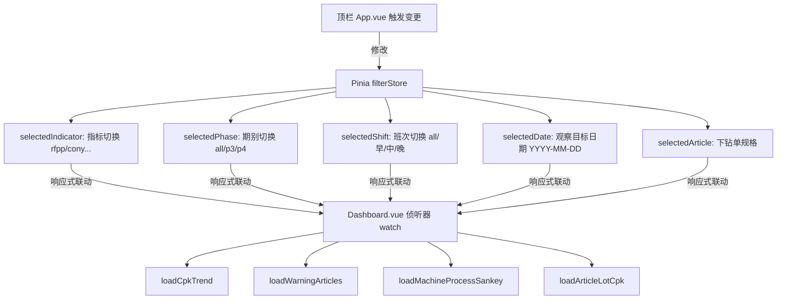

# 06. 前端看板交互与组件状态流转 (Frontend Views & Pinia Flow)

---

## 1. 看板整体四行布局与视觉流向

前端应用源码位于 `src/views/Dashboard.vue`，整体遵循**“宏观大盘 ➔ 核心规格 ➔ 批次单胎 ➔ 设备组合”**的四阶漏斗式视觉流向：

```
+---------------------------------------------------------------------------------------------------+
|  Row 1: 全厂整体宏观指标预览 (全宽 100%)                                                           |
|  [Tab 1: CPK 波动趋势 (SPC 控制限/1.33标杆)]   [Tab 2: Yield 工序不良分布与日环比报警折线]            |
+---------------------------------------------------------------------------------------------------+
|  Row 2: 核心行动表与工序流转 (两列 40% : 60%)                                                     |
|  [左 40%: CoreSpecActionTable 核心规格行动表]  |  [右 60%: MachineProcessSankey 工序流转桑基图]     |
|  - [红/橙/黄] 三级预警规格与机台行动按钮         |  - 成型 -> 硫化 -> 终检变异流动与负贡献节点发光预警    |
+---------------------------------------------------------------------------------------------------+
|  Row 3: 批次与单胎质量追溯 (单日单规格选中时激活, 全宽 100%)                                       |
|  [ArticleLotCpkChart: 胎面/胎圈/帘布/带束层批次 CPK] -> 点击点下钻 [Barcode 散点测量 Run Chart]      |
+---------------------------------------------------------------------------------------------------+
|  Row 4: 机台组合下钻决策树与双线对比 (全宽 100%)                                                   |
|  [MachineCombinationTree: GT+CT+TU 排列组合产出与质量分布] -> [CGRS 调参因果弹窗 CgrsRecordDialog]  |
+---------------------------------------------------------------------------------------------------+
```

---

## 2. 7 大核心业务组件职责与接口调用

系统组件高度模块化，各司其职并通过统一 API 接口通信：

| 组件名称 | 文件位置 | 核心职能 | 调用后端 API |
| :--- | :--- | :--- | :--- |
| **TrendChart** | `src/components/charts/TrendChart.vue` | 绘制全厂/单规格加权 CPK 趋势折线，动态标注 $\pm 1\sigma, \pm 2\sigma, \pm 3\sigma$ SPC 控制限与 1.33 标杆红线 | `/api/trend/cpk` |
| **ProductionAnomalyTrendChart** | `src/components/charts/ProductionAnomalyTrendChart.vue` | 堆叠柱状图展示 TU/TG/TB 及复合工序异常分布，叠加次 Y 轴日环比增幅报警折线 | `/api/trend/production-anomaly` |
| **CoreSpecActionTable** | `src/components/tables/CoreSpecActionTable.vue` | 核心规格两级智能排序、状态指示 [红/橙/黄] 预警、[查看推荐参数] 按钮与跨工序行动指引 | `/api/articles/warning-cpk` |
| **MachineProcessSankeyChart** | `src/components/charts/MachineProcessSankeyChart.vue` | 13 道工序桑基图流转、设备瓶颈高亮发光、单日流向拓扑与全量标杆流向切换 | `/api/machines/process-sankey` |
| **ArticleLotCpkChart** | `src/components/charts/ArticleLotCpkChart.vue` | 原材料半部件（胎面、内衬、带束层等）Lot 批次质量追溯曲线 | `/api/articles/lot-cpk-trend` |
| **BarcodeMeasurementsDialog** | `src/components/modals/BarcodeMeasurementsDialog.vue` | 单日内全部单胎 (Barcode) 实际测量值按时序离散分布图 (Run Chart) 与公差带 | `/api/articles/barcode-measurements` |
| **MachineRecommendParamDialog**| `src/components/dialogs/MachineRecommendParamDialog.vue`| 深度展示成型/硫化机台历史调参轨迹、配方基准值、生效偏置与推荐参数对比表格 | `/api/cgrs/recommended-params` |

---

## 3. 全局状态响应链与 Pinia 状态树

在 `src/store/filterStore.js` 中维护全局单一事实来源 (Single Source of Truth)：



* **自适应联动机制**：
  * 在顶部切换指标为 `cony` 时，SPC 控制限自动切换为双侧公差计算，趋势折线与桑基图同步更新为 CONY 指标；
  * 在桑基图中点击任意成型机或硫化机，自动联动弹出 CGRS 调参分析面板；
  * 点击核心规格表某行，全局广播该规格代码，整屏自动下钻聚焦该规格的批次曲线与机台决策树。

---

## 4. ECharts 响应式重绘与实例内存防漏

在长时间大屏运行场景中，未妥善销毁的 ECharts 实例极易引发浏览器内存泄漏。
系统封装了生命周期自愈规范：
* **容器挂载**：在 `onMounted` 中通过 `echarts.init(domRef.value)` 实例化；
* **尺寸自适应**：通过 `ResizeObserver` 监听 DOM 容器变化，结合 100ms 防抖执行 `chartInstance.resize()`；
* **销毁自愈**：在 `onBeforeUnmount` 钩子中，严格执行：
  ```javascript
  if (chartInstance) {
    chartInstance.dispose()
    chartInstance = null
  }
  ```

---

> [!TIP]
> **下一章导航**：
> 前端与交互已掌握，请阅读 [07. 系统运维部署、排错手册与红线守则](07_devops_and_troubleshooting.md)，了解生产环境部署与运维排错 SOP。
